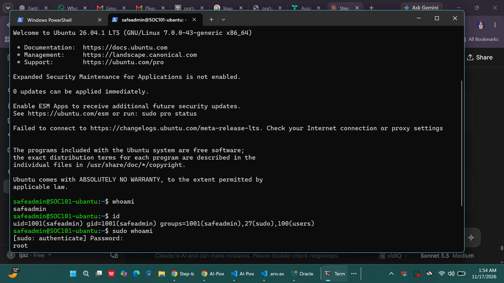
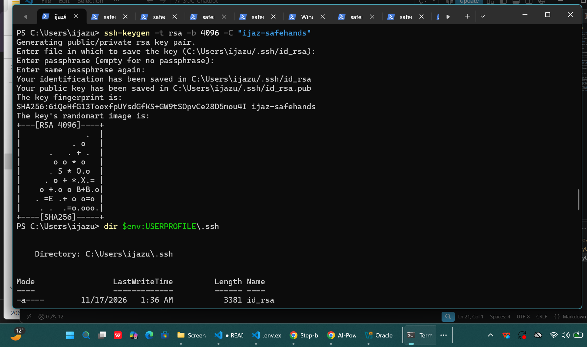
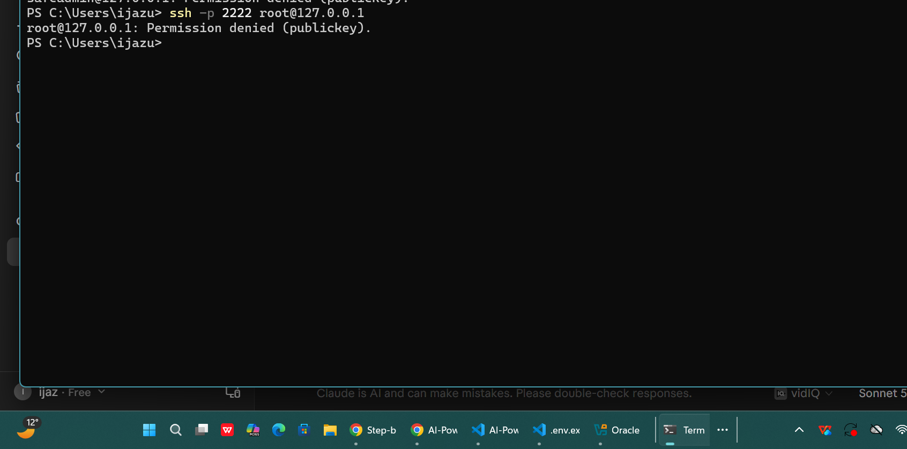
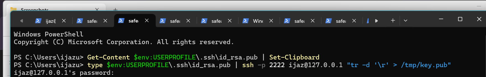
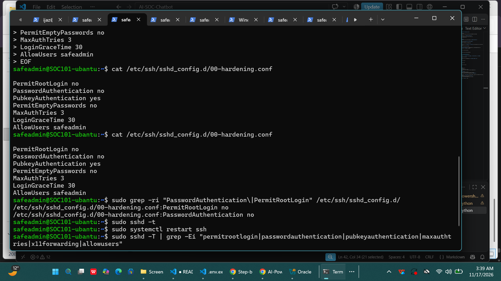
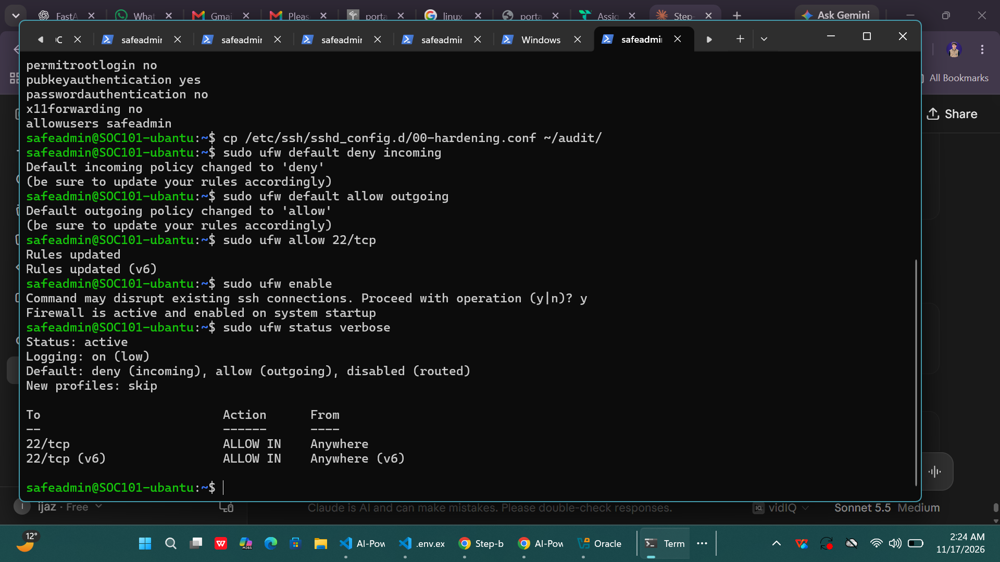
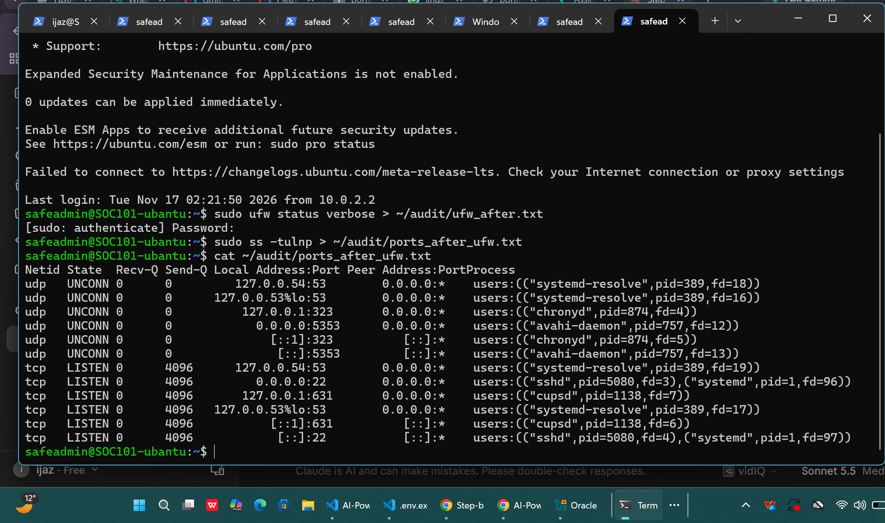
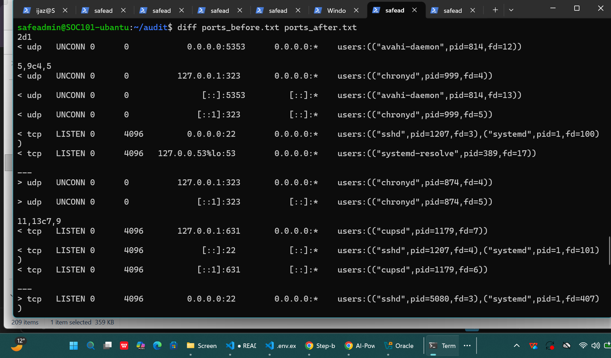
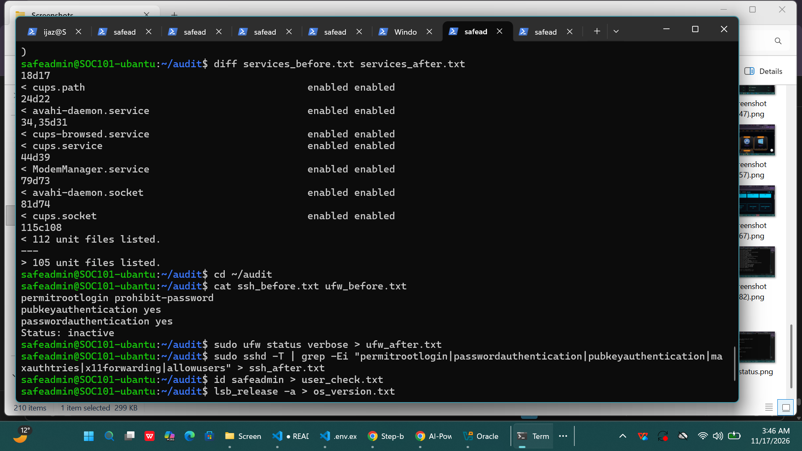

# SafeHands Insurance: Linux Jump Server Hardening (Task 1)

**Intern:** Ijaz Ullah
**Client:** SafeHands Insurance Brokers
**Goal:** Harden an Ubuntu host against common attack vectors and document every change.

## Environment
- Ubuntu Desktop in VirtualBox (version in `evidence/os_version.txt`)
- Hostname: SOC101-ubantu
- Network: NAT with port forward (Windows 127.0.0.1:2222 to VM port 22)
- Admin workstation: Windows with OpenSSH client

## Steps performed

### 1. Update the system
`sudo apt update && sudo apt upgrade -y`
Patches known vulnerabilities before any other change.

### 2. Baseline audit (before changes)
Saved open ports, enabled services, UFW state and SSH settings to `evidence/*_before.txt`.

### 3. Standard user with sudo
Commands: `sudo adduser safeadmin` and `sudo usermod -aG sudo safeadmin`.
Reason: daily admin work should not use root.

### 4. RSA key authentication
Generated a 4096-bit RSA key on Windows with `ssh-keygen -t rsa -b 4096`. Only the public key is in `/home/safeadmin/.ssh/authorized_keys` (permissions 700 and 600). The private key stays on my workstation.

### 5. SSH hardening
Settings in `/etc/ssh/sshd_config.d/00-hardening.conf` (copy in `evidence/`): PermitRootLogin no, PasswordAuthentication no, PubkeyAuthentication yes, PermitEmptyPasswords no, MaxAuthTries 3, LoginGraceTime 30, AllowUsers safeadmin. X11Forwarding set to no in `sshd_config`.

Root login denied:

Password login denied:

Active SSH settings:

### 6. UFW firewall
Commands: `ufw default deny incoming`, `ufw default allow outgoing`, `ufw allow 22/tcp`, `ufw enable`.

### 7. Remove unnecessary services
Disabled avahi-daemon, cups, cups-browsed and ModemManager with `systemctl disable --now`.

Listening ports after hardening:

Ports before vs after:

Services before vs after:

## Before / After

| Item | Before | After |
|---|---|---|
| Root SSH login | prohibit-password | no |
| Password authentication | yes | no |
| Allowed SSH users | all | safeadmin only |
| UFW | inactive | active, deny incoming, allow 22/tcp |
| Network listeners | 22, 53, 323, 631, 5353 | 22 (SSH); 53 and 323 loopback only |
| Enabled unit files | 112 | 105 |

## Verification against the mentor checks
1. UFW active, only SSH allowed: see the UFW screenshot.
2. Password authentication disabled, key login works: see the SSH screenshots.
3. Non-root sudo user, root login disabled: see the id screenshot and `evidence/ssh_after.txt`.

## Lessons learned
- Pasting the wrong clipboard text into `authorized_keys` broke key login. I found it by checking the file size and fixed it by sending the key over SSH.
- A shell wildcard is expanded before `sudo` runs, so I used `sudo sh -c '...'`.
- Files in `sshd_config.d/` can override the main config.
- I took a snapshot and kept a second SSH session open to avoid a lockout.

## Evidence
All before/after outputs are in the `evidence/` folder.
